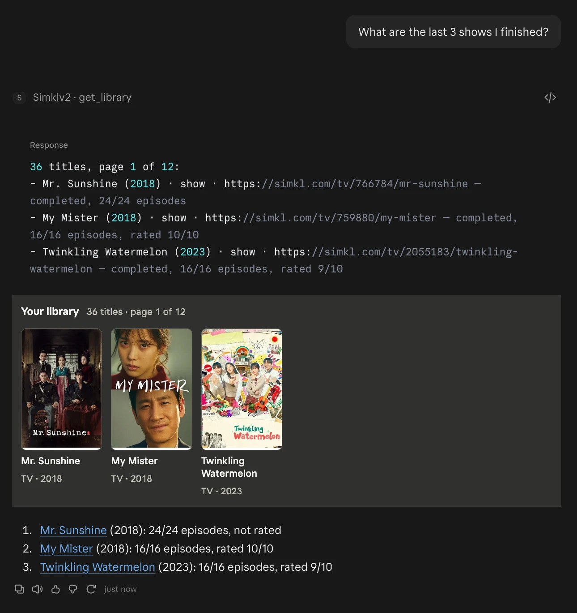
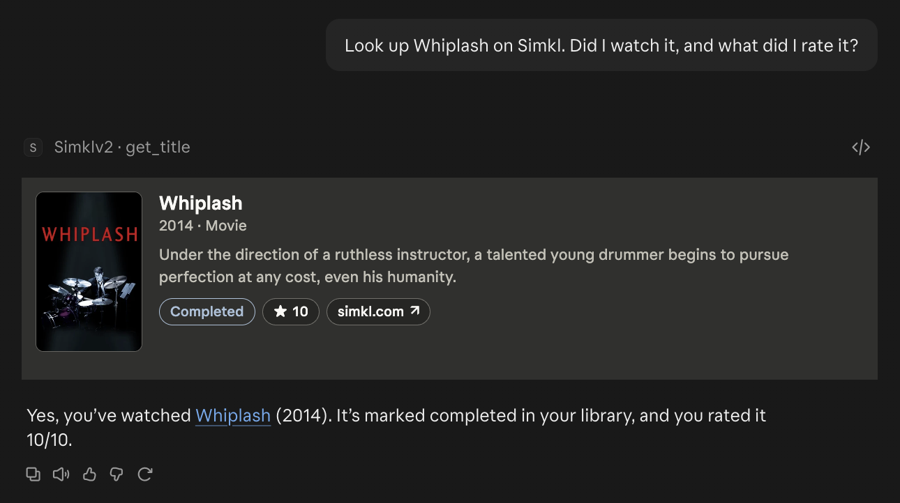

# simkl-mcp


An [MCP](https://modelcontextprotocol.io) server for [Simkl](https://simkl.com): ask Claude what you've watched, what to watch next and what's airing, and have it update your watchlist, history and ratings for movies, TV shows and anime.

<p align="center">
  
</p>

Answers come with cards: in Claude and other hosts that support [MCP Apps](https://modelcontextprotocol.io/extensions/apps/overview), lists render as a poster grid and a title as a detail card with your status and rating. Every other client gets the same answer as text.

<p align="center">
  
</p>

## Connect

Add a custom connector in Claude (**Settings → Connectors → Add custom connector**) with this URL:

```text
https://simkl.xwx.cat/mcp
```

Claude sends you to sign in with Simkl. The connector starts with read access to your library. The first time Claude changes something (marks an episode watched, rates a title), it asks you once more, for write access.

Any MCP client that supports remote servers with OAuth works the same way: the server supports Dynamic Client Registration, so there is nothing to configure.

## What it can do

**Read**
- `search`: find movies, shows and anime by name.
- `get_title`: a title's details, related titles, and where it sits in your library.
- `get_episodes`: a show's or anime's episodes, with what you've watched.
- `trending`: what's popular on Simkl right now, optionally in one genre.
- `calendar`: what airs or releases soon, by default from your own library.
- `get_library`: your library by status, with progress and ratings.
- `up_next`: the next episode of everything you're watching, and paused movies and episodes.
- `get_stats`: time spent and counts by status.

**Write** (needs write access)
- `set_status`: move titles to watching, plan to watch, on hold, completed or dropped.
- `mark_watched`: record titles, seasons or episodes as watched, optionally with a memo.
- `unmark_watched`: remove watches; removing a whole title removes it from your library.
- `rate` / `unrate`: rate titles from 1 to 10, or clear a rating.

Every title links back to its simkl.com page.

## Coming from the old server

This is a rewrite of the earlier TypeScript server. What changed for you:

- **Views**: lists and titles render as cards in hosts with MCP Apps.
- **Sign-in** asks only for read access at first; write access is requested when a tool needs it.
- **Memos** can be attached when marking something watched.
- **Fewer, broader tools**: one tool per question (`get_library`, `up_next`) instead of one per Simkl endpoint.
- **Scrobbling is gone**: live check-ins (`start_watching`, `pause_watching`, `stop_watching`) belong in media players, not chat.

Your Simkl data stays where it is; connect the new URL and sign in once.

## Self-hosting

The server is one Rust binary: the MCP endpoint at `/mcp`, an OAuth 2.1 authorization server in front of Simkl's [AUTH V2](https://api.simkl.org/api-reference/auth-v2), and a SQLite file for its state. Simkl tokens are sealed at rest with your own key.

1. **Register a Simkl app** at [simkl.com/settings/developer](https://simkl.com/settings/developer/) as **Server apps & services**, with the redirect URI `https://<your-host>/auth/simkl/callback` (exactly; add `http://127.0.0.1/auth/simkl/callback` for local development).
2. **Build the image** from the [`Dockerfile`](Dockerfile), or the binary with `cargo build --release -p simkl-mcp` after building the views (below).
3. **Configure it** with environment variables (or a TOML file passed with `--config`, which the variables override):

   | Variable | Value |
   |---|---|
   | `SIMKL_MCP_PUBLIC_URL` | where clients reach it, e.g. `https://simkl.example.com` |
   | `SIMKL_MCP_CLIENT__CLIENT_ID` | your Simkl app's client ID |
   | `SIMKL_MCP_CLIENT_SECRET` | your Simkl app's client secret |
   | `SIMKL_MCP_VAULT_KEY` | `openssl rand -base64 32`; changing it signs everyone out |
   | `SIMKL_MCP_DATABASE` | default `sqlite:///data/simkl-mcp.db` in the image |
   | `SIMKL_MCP_BIND` | default `0.0.0.0:8080` in the image |

   Nested settings use `__`, for example `SIMKL_MCP_AUTH__SIGN_IN_TTL=5m`. Unknown settings are an error, so a typo stops the server at startup.
4. **Run one instance**: pending sign-ins and per-user Simkl rate limits live in memory. On Kubernetes, set `enableServiceLinks: false` on the Pod: a Service named `simkl-mcp` would otherwise inject `SIMKL_MCP_*` variables that the server rejects.

## Development

```bash
nix develop            # Rust, Bun and the rest of the toolchain
cd ui && bun install && bun run build && cd ..   # the views, embedded at compile time
cargo test --workspace
```

- [`crates/simkl-api`](crates/simkl-api): a typed client for the Simkl API, with its rate limits and retries built in.
- [`crates/simkl-mcp`](crates/simkl-mcp): the server: tools, authorization server, and views.
- [`ui`](ui): the MCP Apps views, built into single-file HTML.

The previous TypeScript server (`src/`) still deploys from this repository until the switch is complete.

## License

MIT
