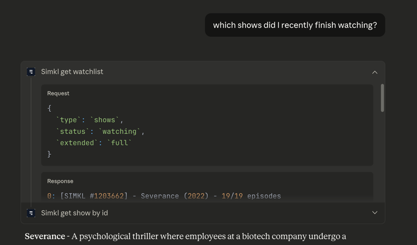

# simkl-mcp


[MCP](https://modelcontextprotocol.io/docs/getting-started/intro) server for [Simkl](https://simkl.com) — track movies, TV shows, and anime with autogenerated tools (Cloudflare Workers + Bun).



## Setup
- Create a Simkl OAuth app and grab `SIMKL_CLIENT_ID` and `SIMKL_CLIENT_SECRET` (redirect URI must match `.../oauth/callback`).
- Add a `.dev.vars` (or Wrangler secrets) with:
  ```bash
  SIMKL_CLIENT_ID=your_client_id
  SIMKL_CLIENT_SECRET=your_client_secret
  OAUTH_REDIRECT_URI=http://localhost:8787/oauth/callback
  ```
- Install deps: `bun install`

## Local (Streamable HTTP)
Run the worker with Wrangler and point your MCP client at the Streamable HTTP endpoint.
```bash
bun run dev
```
Add to `claude_desktop_config.json` (or equivalent):
```json
{
  "mcpServers": {
    "simkl": {
      "transport": "streamable-http",
      "url": "http://localhost:8787/mcp"
    }
  }
}
```
For local development, use `http://localhost:8787/mcp`; for a deployed Worker, replace the host with your Worker URL, such as `https://your-worker.workers.dev/mcp`. On first connect, you’ll be redirected to Simkl to approve access, then returned to `/oauth/callback`.

The `/sse` endpoint remains available for MCP clients that require the legacy SSE transport. Prefer `/mcp` for new connections.

## Deploy (Cloudflare Workers)
```bash
wrangler secret put SIMKL_CLIENT_ID
wrangler secret put SIMKL_CLIENT_SECRET
wrangler secret put OAUTH_REDIRECT_URI # e.g., https://your-worker.workers.dev/oauth/callback
bun run deploy            # staging
bun run deploy:production # optional
```
Configure remote MCP clients to use `https://your-worker.workers.dev/mcp` with Streamable HTTP (Claude: Settings → Connectors → Add Server). Use `https://your-worker.workers.dev/sse` only for clients that still require the legacy SSE transport.

## Tools
- **Search**: `simkl_search`, `simkl_search_id`
- **Scrobble**: `simkl_scrobble_start`, `simkl_scrobble_pause`, `simkl_scrobble_stop`
- **Sync/Tracking**: `simkl_sync_add_to_list`, `simkl_sync_history`, `simkl_sync_history_remove`, `simkl_sync_ratings`, `simkl_sync_ratings_remove`
- **Discovery**: trending/best/details/episodes/genres for tv, movies, anime (13 tools)
- **User**: `simkl_users_stats`, plus custom `simkl_my_stats`
- **Resources**: `watchlist/{type}/{status}`, `trending/{type}/{interval}`

## Authentication
- Public requests add `client_id` as a query param; authenticated calls use `Authorization: Bearer <token>`.
- The Worker handles OAuth: `/auth/simkl` redirects to Simkl, `/oauth/callback` exchanges the code and issues MCP credentials.
- Tokens are long-lived; for local dev, secrets live in `.dev.vars`, for production use Wrangler secrets and KV (`OAUTH_KV`) for state.

## Development
```bash
# regenerate tools from the OpenAPI spec
bun run codegen

# typecheck
bun run typecheck

# health check
curl http://localhost:8787/health
```

## License
MIT

## Trending by genre

`simkl_get_trending_by_genre` returns monthly rankings from Simkl's public CDN,
updated daily. These CDN reads need no Simkl user token and do not consume the
Simkl API daily quota or per-second allowance. Live genre-browsing tools retain
their existing behavior and filters.

Example input: `{ "type": "anime", "genre": "action", "maxResults": 20 }`.
Supported media types are `tv`, `movies`, and `anime`. Use an exact slug from
`https://data.simkl.in/discover/trending/{type}/genre/index.json`; slugs differ by
media type. The tool validates that index before reading
`{genre}_month_500.json` from the same directory. The CDN file contains up to
500 titles and has no upstream pagination. `maxResults` defaults to 20 and must
be an integer from 1 to 100.

The response contains `type`, `period`, `genre`, `total`, `returned`, `results`,
and `updatedAt` (the file's Last-Modified header, or null when absent). Results
preserve the CDN fields and include a `simkl_url` attribution link when a Simkl
ID is available. It makes no per-title detail requests. Invalid genres, malformed
responses, and failed reads return an MCP error rather than an empty success.

Validation uses HTTP fixtures; it does not establish live CDN availability.
